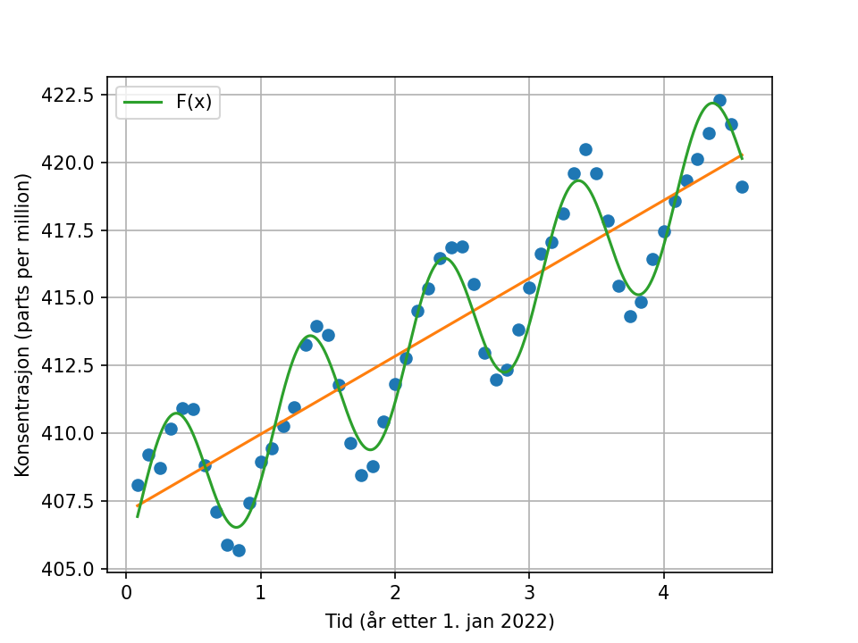
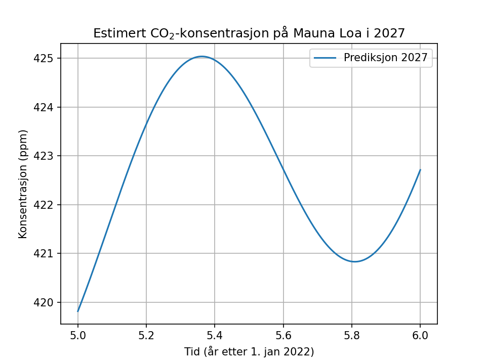

# CO₂-regresjon – Mauna Loa

Modellering av CO₂-konsentrasjonen ved Mauna Loa-observatoriet (januar 2022 – juli 2026) med lineær og ikke-lineær regresjon. Parametrene i den ikke-lineære modellen er funnet med gradientmetoden. Prosjektet var en individuell innlevering i MEK2000 (Matematikk 2) ved OsloMet høsten 2026.

## Modell

Dataene har to tydelige mønstre: en jevn økning over tid og en sesongsvingning som gjentar seg hvert år. Modellen fanger begge:

$$F(x) = a + bx + c\sin(dx + f)$$

der $x$ er år etter 1. januar 2022 og $F(x)$ er konsentrasjonen i ppm.

## Fremgangsmåte

1. **Lineær regresjon:** Minste kvadraters metode gir trendlinja $y = 407{,}09 + 2{,}87x$.
2. **Kostfunksjon:** Parametrene velges slik at summen av de kvadrerte avvikene blir minst mulig:
   $$S(a,b,c,d,f) = \sum_{i=1}^{M} \left[ y_i - a - bx_i - c\sin(dx_i + f) \right]^2$$
3. **Gradientmetoden:** Hver parameter oppdateres med $p_{n+1} = p_n - \lambda \, \partial S / \partial p$. De partielle deriverte regnes numerisk med midtpunktsformelen.
4. **Startverdier:** $a$ og $b$ er hentet fra den lineære regresjonen. Amplituden $c_0 = 3$ er lest av plottet, og $d_0 = 2\pi$ tilsvarer en periode på ett år.
5. **Valg av $\lambda$, $h$ og $N$:** Disse er testet systematisk. Endelige verdier er $\lambda = 10^{-5}$, $h = 0{,}001$ og $N = 10\,000$ iterasjoner.

## Resultat

$$F(x) = 406{,}930 + 2{,}866x + 2{,}782\sin(6{,}296x - 0{,}610)$$

- **Periode:** $T = 2\pi/d \approx 0{,}998$ år, altså én sesongsyklus per år.
- **Trend:** CO₂-nivået øker med omtrent 2,87 ppm per år.
- **Prognose:** Modellen gir ca. 419,8 ppm ved nyttår 2026/2027.

## Filer

| Fil | Innhold |
|---|---|
| `co2_regresjon.py` | All kode, delt opp etter deloppgave |
| `data.csv` | Datasettet (x = år etter 1. jan 2022, y = ppm) |
| `Figurer/` | Plott |

Bruker Python med pandas, NumPy og matplotlib.

## Kilder

- Datasett: [MEK2000-repoet til emnet](https://github.com/Soelve/MEK2000/blob/main/Regresjon/Datasett.dat), med måledata fra [NOAA Global Monitoring Laboratory](https://gml.noaa.gov/ccgg/trends/)
